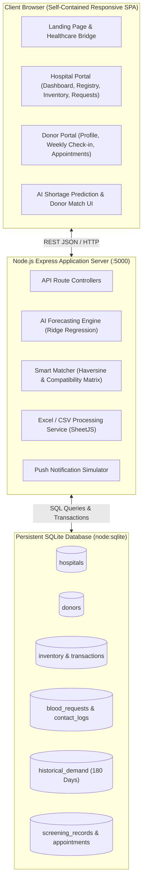

# 🩸 RaktSetu — AI-Powered Blood Inventory & Donor Coordination Platform

> **"Every Drop Matters. Every Connection Saves Lives."**  
> *Academic Demonstration Prototype — Artificial Intelligence, Data Science & Healthcare Technology*

---

## 1. Executive Summary & Problem Statement

Hospitals and blood centres continually struggle to balance critical blood inventory:
- **Storage & Expiry Challenges:** Blood components have strict shelf lives (Platelets expire in 5 days; PRBC in 42 days; Whole Blood in 35 days; Plasma in 365 days). Over-collecting leads to wastage, while under-collecting causes life-threatening shortages.
- **Uncoordinated Donor Data:** Many blood banks still maintain donor records in fragmented Excel spreadsheets or manual registers, leading to slow emergency mobilization.
- **Proactive Need:** When emergency trauma arrives, finding compatible, medically eligible, and physically nearby donors who are available this week is time-critical.

**RaktSetu** bridges this gap by unifying hospital inventory tracking, digitizing spreadsheet records, forecasting 7-day blood demand using regularized machine learning time-series regression, and dynamically prioritizing verified standby donors with explainable AI recommendations.

> **Important Healthcare Principle:** RaktSetu is a clinical decision-support and donor coordination aid. It does **not** replace blood banks, qualified medical staff, clinical screening tests, or component compatibility cross-matching. Donor availability does not guarantee medical fitness.

---

## 2. System Architecture



---

## 3. Quick Start & Execution Instructions

### Prerequisites
- Node.js **v20+** or **v24+** (Built-in `node:sqlite` enabled)
- npm

### Installation & Run
```bash
# 1. Clone or open repository folder
cd Raktsetu

# 2. Install dependencies
npm install

# 3. Start the unified server
npm start
```

### Accessing the Platform
Open your browser and navigate to:  
👉 **`http://localhost:5000`**

---

## 4. Demo Login Credentials & Quick Switcher

For college evaluators and presentations, a **Demo Accelerator Bar** is pinned to the top of the interface for instantaneous 1-click account switching:

| Role | Name | Email / Mobile | Password | Pre-configured State |
| :--- | :--- | :--- | :--- | :--- |
| **Hospital 1** | Metro General Hospital & Trauma Centre | `metro.bloodbank@raktsetu.org` | `hospital123` | South Mumbai, full ICU inventory, active urgent requests |
| **Hospital 2** | City Life Charitable Blood Bank | `citylife.bank@raktsetu.org` | `hospital123` | Andheri West, suburban donor pool |
| **Donor (Approved)** | Rahul Sharma (O+) | `+91 98765 43210` | *N/A (1-Click)* | Validated medical approval, available this week |
| **Donor (Pending)** | Sneha Deshmukh (B+) | `+91 98765 43213` | *N/A (1-Click)* | Newly registered, awaiting hospital screening |
| **Donor (O- Universal)** | Priya Patel (O-) | `+91 98765 43211` | *N/A (1-Click)* | Universal RBC donor within 2.5 km of Metro Hospital |

---

## 5. End-to-End Walkthrough of Required Demonstrations

### DEMO 1: Donor Self-Registration
1. Click **"Register as a Donor"** on the landing page or top bar.
2. Fill out the form (e.g., Name: `Vikrant Patil`, DOB: `1997-03-20` — Age automatically calculates to `29`, Blood Group: `O-`, PIN: `400012`).
3. Notice the mandatory healthcare disclaimer: *"Registration does not mean you are medically approved to donate blood..."*.
4. Submit the form. The profile is saved in SQLite with status **`PENDING SCREENING`** and opens the donor portal.

### DEMO 2: Excel / CSV Donor Import
1. Navigate to **Hospital Portal** ➔ **Donor Registry & Screening** tab.
2. Click **"Template (.xlsx)"** to download the standard hospital spreadsheet.
3. Click **"Import Excel / CSV"**, select or drag a file (`.xlsx`, `.xls`, `.csv`).
4. RaktSetu previews the rows, auto-maps columns, validates phone numbers and blood groups, and detects duplicate records against the SQLite database.
5. Review the summary (Valid vs Duplicate vs Invalid rows) and click **"Confirm & Save Valid Records"**. All valid records are inserted with status **`PENDING VERIFICATION`**.

### DEMO 3: Hospital Screening & Approval Workflow
1. In the **Donor Registry**, locate a donor with **`PENDING SCREENING`** (e.g. Sneha Deshmukh or your newly registered donor).
2. Click **"Schedule"**, select appointment date & time, enter instructions, and submit. Status transitions to **`APPOINTMENT SCHEDULED`** and reflects on the donor's portal.
3. Once completed, click **"Decide"**, enter doctor notes (e.g. `Hb: 13.8 g/dL, BP: 120/80`), choose **`APPROVED`** (or `TEMPORARILY DEFERRED`), and save.
4. The donor is now medically approved and eligible for the active matching pool.

### DEMO 4: Weekly Availability Check-in
1. Switch to **Donor Portal** (e.g., Rahul Sharma or Priya Patel).
2. View the prominent Weekly Availability card: *"Will you be available to help save a life next week? Tap to update your availability. 🩸"*.
3. Click **"❤️ Yes, I'm available"** (or click the top bar button **"🔔 Test Weekly Push"** to test the simulated mobile lockscreen popup).
4. Response is recorded with timestamp in SQLite (`availability_responses` table).
5. Switch to **Hospital Portal** ➔ Dashboard to see the **"Available This Week"** metric update immediately.

### DEMO 5: AI Blood Shortage Demand Forecasting
1. Go to **Hospital Portal** ➔ **AI Shortage Prediction** tab.
2. Select Blood Group **`O-`** and Component **`Packed Red Blood Cells (PRBC)`**.
3. Click **"Run Model Forecast"**.
4. The mathematical model runs over 180 days of historical demand, displaying:
   - 7-day projected demand vs usable stock.
   - Interactive SVG forecast chart with **90% confidence corridor**.
   - Net shortage calculation and risk classification (**CRITICAL / HIGH / MEDIUM / LOW**).
   - Explainable contributing factors (e.g., "Weekend emergency trauma harmonic", "Critically depleted stock baseline").
   - Actionable clinical coordination recommendations.

### DEMO 6: Smart Donor Prioritization & Outreach
1. In **Hospital Portal** ➔ **Urgent Requests & Matching** tab.
2. Click **"+ Submit New Blood Request"** (e.g. `O-` PRBC, 2 units, Urgency: `CRITICAL`).
3. Click **"Run Smart Matching"**.
4. RaktSetu filters the pool using component compatibility, active medical approval, rest interval, and weekly availability.
5. Displays candidate ranking scored (0–100) using Haversine geodesic distance, confirmed availability, and screening freshness.
6. Read the natural-language explanation generated per candidate (e.g. *"Prioritised because donor has valid screening approval, is located approx 1.1 km away, is available this week, and has exact blood group match (O-)."*).
7. Click **"Mobilise"** to simulate contact. The action is logged to `donor_contact_records` and updates request status to **`DONORS CONTACTED`**.

### DEMO 7: Blood Inventory & Component-Specific Expiry
1. Go to **Hospital Portal** ➔ **Blood Inventory & Expiry** tab.
2. Observe component-specific shelf lives:
   - **Platelets:** 5 Days (Agitator at 22°C) — highlights near-expiry pulse badge.
   - **Whole Blood:** 35 Days (2-6°C).
   - **PRBC:** 42 Days (2-6°C).
   - **Plasma:** 365 Days (-30°C).
3. Expired units are highlighted in red and quarantined (prevented from being issued).
4. Click **"Add Stock Intake"** to record new units; click **"Issue Unit"** to dispense units for a patient, and verify real-time inventory updates.

---

## 6. Technical Implementation Details

### A. AI Demand Forecasting Engine (`server/ai/demandForecasting.js`)
- **Mathematical Model:** Multivariate Ridge Regularized Linear Regression:
  $$\beta = (X^T X + \lambda I)^{-1} X^T Y$$
- **Engineered Features ($X$):**
  1. Normalized linear time trend ($t$)
  2. One-hot day-of-week indicators (Sunday, Saturday, Weekday)
  3. Cyclical seasonal harmonics ($\sin(2\pi t / 28)$ and $\cos(2\pi t / 28)$)
  4. Autoregressive terms ($\text{Lag-1}$, $\text{Lag-7}$ same weekday)
  5. Rolling baseline (7-day moving average)
- **Evaluation:** Calculates coefficient of determination ($R^2$) and Mean Absolute Error (MAE) dynamically.
- **Risk Classifier:** Compares projected demand against unexpired usable stock and incoming donor appointments.

### B. Intelligent Donor Matching Engine (`server/ai/donorMatching.js`)
- **Compatibility Matrix:** Component-specific rules (PRBC universal donor O-, universal recipient AB+; Plasma universal donor AB, universal recipient O).
- **Haversine Geodesic Distance:**
  $$d = 2R \arcsin \left( \sqrt{\sin^2\left(\frac{\Delta \phi}{2}\right) + \cos \phi_1 \cos \phi_2 \sin^2\left(\frac{\Delta \lambda}{2}\right)} \right)$$
- **Explainable Multi-Criteria Priority Function:**
  $$\text{Score} = w_{\text{compat}} + w_{\text{dist}} \left(1 - \frac{d}{r}\right) + w_{\text{avail}} + w_{\text{screening}} + w_{\text{rest}}$$
  Generates a transparent, human-readable paragraph justifying why each donor was ranked at their position.

### C. Offline Standalone Frontend Engine
- Built with zero external CDN dependencies to ensure 100% offline demonstration reliability.
- Custom vector SVG icons and interactive SVG chart rendering engine (`public/js/utils/charts.js`).

---

## 7. Known Limitations & Future Scope

| Current Prototype Scope | Future Production Enhancements |
| :--- | :--- |
| Synthetic historical hospital demand data | Real-time EHR / HIS HL7 FHIR hospital integration |
| Simulated push notifications & SMS outreach | Live Twilio WhatsApp / Firebase Cloud Messaging (FCM) production gateway |
| Approximate municipal coordinate mapping | High-precision GPS routing with real-time transit traffic estimation |
| Single-server embedded SQLite database | Distributed PostgreSQL with row-level security (RLS) & HIPAA/DISHA encryption |

---

*Academic Project Submitted for College Evaluation in Artificial Intelligence, Data Science & Healthcare Technology.*
